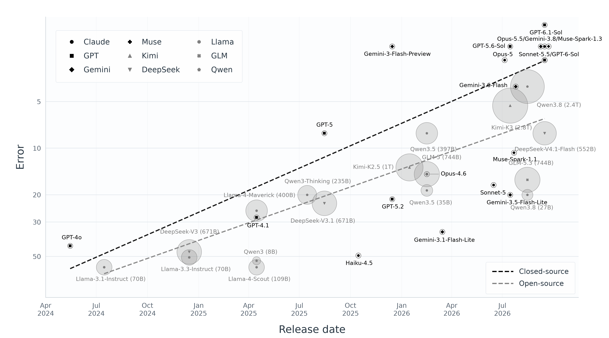

<div align="center">

<h1>LLMs Can Tackle High Energy Theoretical Physics, yet Gaps Remain:<br>Part I, Quantum Field Theory</h1>

<p align="center">
  <a href="https://arxiv.org/abs/2610.33134">📄 Paper</a> |
  <a href="https://huggingface.co/datasets/Meikel/ProactEgoMem">🤗 Data</a> 
</p>
</div>

<!--
## 📣 News
- **[2026-10] Part I: QFT-Bench, released**
-->

<h2>Overview</h2>
<p align="center"><br><b>LLM Scaling Law on QFT-Bench</b></p>

<h2> How to use the data? </h2> 

```python
from datasets import load_dataset

dataset = load_dataset("LLMsHEP/QFT-Bench", split="test")

print(f"Number of problems: {len(dataset)}")
print(dataset[0]["question"])
```

<h2> How to evaluate? </h2> 

### Step 1. Generate your model's answers
Run your model on our benchmark. Prompt each problem with `Let's think step by step and output the final answer within \boxed{}.` followed by the question.  

Save the results as a JSON file containing a list with one entry per problem, e.g. `results_gpt-6-1-sol.json`:

This points to a JSON file containing a list with one entry per problem:

| Field | Description |
|---|---|
| `question` | problem text, exactly as in the dataset |
| `reference_answer` | the dataset's `answer` |
| `model_answer` | content of the model's last `\boxed{...}`; `null` if there is none (counts as wrong) |
| `solution` | the model's full response |
| `category` | the dataset's `category` |
| `specific_requirement`, `reference_answer_alt`, `numeric_tolerance` | copied from the dataset **only when non-null**; omit the key otherwise (a `null` `reference_answer_alt` crashes the sympy check) |

`reference_solution` (the dataset's `solution`) is optional. If it is missing, it is filled in automatically from the Hub, matched by `question` text.


### Step 2. Evaluate using LLM-as-a-judge  
Set your Claude API token. 
```bash
export ANTHROPIC_API_KEY="sk-ant-..."
```

Then run: 
```bash
OUTPUT_PATH={MODEL_RESULTS}.json
python evaluate.py -output_path ${OUTPUT_PATH}
```

Each answer is first checked by sympy; the ones sympy does not accept are graded by Claude. The console shows the sympy-only accuracy, then the final accuracy:

```
Sympy-match accuracy: NN/75 = XX.X%

Re-grading NN/75 items that sympy marked wrong
LLM-as-a-judge accuracy: NN/75 = XX.X%                     <- final accuracy
Accuracy by category:
  ...
```


<h2>Citation</h2>
<pre>@article{llmsqft,
  title   = {LLMs Can Tackle High Energy Theoretical Physics, yet Gaps Remain: Part I, Quantum Field Theory},
  author  = {Liu, Tong and Li, Bohan and Cheng, Gongrui and Yu, Zixiong and He, Yulan and Tresp, Volker},
  journal = {arXiv preprint arXiv:2610.33134},
  url     = {https://qft-bench.github.io/},
  year    = {2026}
}</pre>
